---
id: tutoriais-exportar-pdf-e-json
title: Tutoriais Interativos — Exportação em PDF A4 & Backup/Importação JSON
category: Onboarding & Tutoriais
system: Mighty Blade 3e & Foundry VTT v14
author: Guilherme Breder
date: 2026-09-15
status: Concluído
tags:
  - tour-guiado
  - exportacao-pdf
  - json-foundry
  - vtt-v14
  - onboarding
  - ssot
---

# 📄 Tutoriais Interativos: Exportação em PDF A4 & Backup/Importação JSON

Este documento registra a especificação, arquitetura e guia de manutenção dos dois novos tutoriais interativos adicionados à **Central de Tutoriais & Ajuda** da plataforma **Mesas do Breder**:
1. **Exportando sua Ficha em PDF (A4 Oficial)** (`tour-exportar-pdf`): Guia prático de diagramação canônica em folha A4 e impressão para mesas presenciais.
2. **Backup & Portabilidade: Exportar e Importar JSON** (`tour-exportar-importar-json`): Guia de backup offline-first, restauração no Dashboard e compatibilidade com o Foundry VTT v14.

Ambos os tutoriais complementam a trilha de aprendizagem gamificada iniciada em [[dmv-mobile-e-tour-interativo-high-end]].

---

## 🎯 1. Objetivos Pedagógicos & Experiência de Usuário (UX)

### Tutorial 1: Exportação em PDF (`tour-exportar-pdf`)
* **Problema Resolvido:** Jogadores novatos que desejavam imprimir sua ficha em papel para jogar em mesas de garagem ou eventos presenciais tinham dúvidas sobre como gerar o PDF e como configurar o navegador para não cortar as margens.
* **Solução:**
  * Apresenta o botão `[🖨️ Imprimir / Exportar]` diretamente na barra de ações da ficha (`FichaDetalhe.tsx`).
  * Demonstra a folha oficial diagramada clássica em escala 100% A4 com moldura heráldica, campos de atributos e defesas calculadas.
  * Ensina a configurar a impressão do navegador: selecionar *"Salvar como PDF"*, margens *"Nenhuma"* ou *"Padrão"* e marcar *"Gráficos de segundo plano"* para visualização idêntica ao livro básico do Mighty Blade 3e.

### Tutorial 2: Exportar e Importar JSON (`tour-exportar-importar-json`)
* **Problema Resolvido:** Jogadores que trocam de celular/computador ou mestres que querem importar as fichas de seus jogadores no **Foundry VTT v14** não sabiam onde ficava a exportação nem como restaurar o arquivo `.json`.
* **Solução:**
  * Explica a filosofia **Offline-First**: como os heróis ficam gravados no armazenamento local (`localStorage`), o backup em `.json` é a garantia de segurança perpétua e portabilidade sem necessidade de servidores externos.
  * Apresenta o botão `[💾 .json]` na barra do modal de exportação da ficha.
  * Ensina o fluxo de restauração no Dashboard através do botão `[📥 Importar JSON]`, demonstrando como o validador canônico impede fichas corrompidas e previne duplicatas por nome.
  * Explica a integração com o módulo oficial do Mighty Blade 3.5 para Foundry VTT v14.

---

## 🧩 2. Trilha de Aprendizagem Gamificada (Learning Chain)

Com a adição dos novos tutoriais, a jornada do usuário no Mesas do Breder forma uma sequência lógica e fluida:

```mermaid
graph LR
    A["🎲 Primeiros Passos<br/>(tour-dashboard-onboarding)"] --> B["🧙‍♂️ Criação do 1º Herói<br/>(tour-criacao)"]
    B --> C["📈 Evolução & Caminho<br/>(tour-evolucao)"]
    C --> D["🎓 Especialização / Aprendiz<br/>(tour-aprendiz)"]
    D --> E["⚔️ Mesa & Combate 3d6<br/>(tour-mesa)"]
    E --> F["📄 Exportar em PDF A4<br/>(tour-exportar-pdf)"]
    F --> G["💾 Backup & VTT JSON<br/>(tour-exportar-importar-json)"]

    style A fill:#1e293b,stroke:#3b82f6,stroke-width:2px,color:#fff
    style B fill:#1e293b,stroke:#fbbf24,stroke-width:2px,color:#fff
    style C fill:#1e293b,stroke:#10b981,stroke-width:2px,color:#fff
    style D fill:#1e293b,stroke:#8b5cf6,stroke-width:2px,color:#fff
    style E fill:#1e293b,stroke:#ef4444,stroke-width:2px,color:#fff
    style F fill:#1e293b,stroke:#f59e0b,stroke-width:3px,color:#fff
    style G fill:#1e293b,stroke:#06b6d4,stroke-width:3px,color:#fff
```



---

## 🗺️ 3. Elementos Mapeados com `data-tour`

Para permitir que o motor de holofote SVG (`TourSpotlight.tsx`) e os popovers flutuantes destaquem os botões contextuais exatos, os seguintes atributos foram integrados:

| Elemento | Arquivo Fonte | Atributo `data-tour` | Descrição |
| :--- | :--- | :--- | :--- |
| **Primeiro Card de Personagem** | `Dashboard.tsx` | `card-personagem-primeiro` | Destaca a primeira ficha da lista/grade para orientar o clique |
| **Botão Visualizar Ficha** | `Dashboard.tsx` | `btn-abrir-ficha-primeiro` | Botão primário para abrir a visualização detalhada |
| **Botão Importar JSON** | `Dashboard.tsx` | `btn-importar-json` | Botão no cabeçalho do Dashboard para upload de arquivo `.json` |
| **Botão Imprimir / Exportar** | `FichaDetalhe.tsx` | `btn-imprimir-exportar` | Botão dourado de ação no cabeçalho superior da ficha |
| **Botão Salvar PDF / Imprimir** | `FichaImpressaoModal.tsx` | `modal-btn-pdf` | Botão primário da toolbar do modal de impressão |
| **Botão Baixar JSON** | `FichaImpressaoModal.tsx` | `modal-btn-json` | Botão secundário da toolbar do modal de impressão |

---

## 💻 4. Estrutura dos Schemas em `toursData.ts`

```typescript
// tour-exportar-pdf
{
  id: "tour-exportar-pdf",
  system: "mightyblade",
  title: "Exportando sua Ficha em PDF (A4 Oficial)",
  subtitle: "Geração, diagramação canônica A4 e impressão para mesa presencial",
  description: "Aprenda a gerar a ficha canônica oficial do Mighty Blade 3e em folha A4 diagramada, pronta para salvar em PDF ou imprimir na sua mesa de RPG.",
  icon: "📄",
  badge: "Impressão & PDF",
  category: "iniciante",
  duration: "2 min",
  nextTourId: "tour-exportar-importar-json",
  nextTourTitle: "Backup & Portabilidade: Exportar e Importar JSON",
  recommendedRoute: "/dashboard",
  steps: [
    { id: "pdf-1", targetSelector: '[data-tour="card-personagem-primeiro"]', ... },
    { id: "pdf-2", targetSelector: '[data-tour="btn-imprimir-exportar"]', ... },
    { id: "pdf-3", position: "center", ... },
    { id: "pdf-4", targetSelector: '[data-tour="modal-btn-pdf"]', ... },
    { id: "pdf-5", position: "center", ... },
  ]
}

// tour-exportar-importar-json
{
  id: "tour-exportar-importar-json",
  system: "global",
  title: "Backup & Portabilidade: Exportar e Importar JSON",
  subtitle: "Backup seguro, troca entre amigos e integração com Foundry VTT v14",
  description: "Descubra como exportar o arquivo .json completo do seu personagem para backup, compartilhar com o mestre ou carregar no Foundry VTT v14.",
  icon: "💾",
  badge: "Backup & VTT",
  category: "iniciante",
  duration: "2 min",
  recommendedRoute: "/dashboard",
  steps: [
    { id: "json-1", position: "center", ... },
    { id: "json-2", targetSelector: '[data-tour="modal-btn-json"]', ... },
    { id: "json-3", targetSelector: '[data-tour="btn-importar-json"]', ... },
    { id: "json-4", position: "center", ... },
  ]
}
```

---

## 🔗 5. Conexão com o Foundry VTT v14

O arquivo `.json` gerado pelo botão `[💾 .json]` implementa o schema canônico `FichaCanonica`:
* **Identificação:** `name`, `type: "character"`, `img`.
* **System Details:** Nível, Pontos de Experiência, Dinheiro/Moedas, Raça, Classe, Caminho, Antecedente, Motivação.
* **Atributos:** Força, Agilidade, Inteligência e Vontade com cálculos derivados em tempo de execução.
* **Itens (`items[]`):** Habilidades, magias, equipamentos, armas, armaduras e escudos com propriedades estruturadas.

No Foundry VTT v14 (conforme detalhado em [[manual-do-sistema]] e [[foundry-v14-architecture]]), o sistema oficial do Mighty Blade 3.5 possui um importador nativo com 1 clique que processa este `.json` e popula automaticamente os DataModels sem requisições de rede.

---

## 📋 6. Referências Cruzadas
* [[dmv-mobile-e-tour-interativo-high-end]] — Sistema base de tours, holofotes SVG e prevenção de render loops.
* [[foundry-v14-architecture]] — Arquitetura de DataModels e compêndios do Foundry VTT v14.
* [[manual-do-sistema]] — Manual de regras do Mighty Blade 3.5 para mesas virtuais.
* [[TODO]] — Backlog geral de tarefas e roadmap do monorepo.
